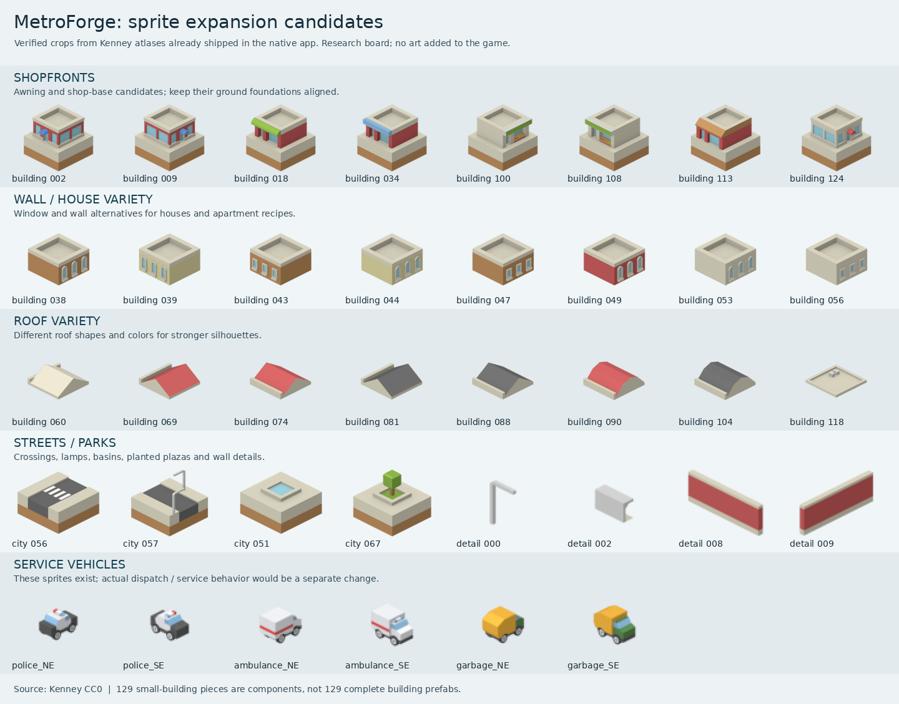

# MetroForge sprite expansion review

Historical research snapshot: the subsequent 0.3.2 optimization improved populated-city performance, and the first building expansion is now implemented in source. See [the performance report](../../godot/docs/performance-0.3.2.md) and [building variety and automatic growth](../../godot/docs/building-variety.md) for current behavior.

The strongest first expansion is **more variety from the Kenney atlases already shipped in the app**, followed by distinctive civic/industrial artwork. Harbor City's Galaxy S25+ slowdown remains unresolved; the user explicitly deferred optimization to a later request. This pass reviews artwork and records future work only.

The board shows original atlas crops, not assembled or implemented new buildings. Source art is Kenney CC0.

## What the two uploaded files establish

The supplied inventory is careful about the difference between components and finished buildings. The JSON has **417 unique entries and 1,185 unique image paths**, with no duplicate IDs or paths:

| Family | Indexed identities | Expanded image paths | Fit for the current art |
| --- | ---: | ---: | --- |
| Isometric Tiles Buildings | 129 | 129 | Best starting family; already in the native building atlas |
| Isometric Modular Buildings | 101 | 404 | Four views per component; 180 × 115 ground footprint needs conversion |
| Isometric Vector Buildings | 155 | 620 | Four materials per shape; usually 50 px wide and a different visual density |
| Vector awnings | 32 | 32 | Storefront details for the vector family; require deliberate adaptation elsewhere |

These counts do **not** mean 1,185 distinct buildings or 417 ready-to-place prefabs. Most records explicitly lack a verified semantic classification.

I checked all 129 small-building canvas sizes against the existing atlas/XML: **129 match**. Visible alpha bounds match for 121; eight differ by one pixel at the top or left edge: `071`, `077`, `078`, `086`, `094`, `102`, `110`, `111`. This is a comparison with packed atlas crops, not fresh standalone source PNGs, so it does not prove the index is wrong. It does mean alpha bounds should be remeasured when choosing anchors. The index supplies bounds, not a proven ground contact point.

## What the current app actually uses

The five native atlas PNGs match their recorded SHA-256 receipts. They already contain **129 building pieces, 128 city pieces, 128 landscape pieces, 11 detail pieces and 64 utility-vehicle frames**.

The building renderer actively uses only these five building pieces:

- `buildingTiles_045` and `048`: red/beige house-floor choices.
- `buildingTiles_000`: the office floor, also reused for shops.
- `buildingTiles_065`: the house roof.
- `buildingTiles_005`: the flat roof used elsewhere.

Apartments repeatedly use the same red floor; offices and shops repeatedly use the same blue-window floor. That explains much of Harbor City's visual repetition. **124 other building pieces are not used by the live building renderer.** Of these, 123 are unmapped; `032` has an `industry` alias but is not used by the industrial rendering path. Visually, `032` is an ordinary brown windowed floor, not a dedicated factory.

Other restrictions are similarly narrow: one tree detail, two city-surface mappings and four diagonal taxi views. Industrial/civic structures and trains are still procedural artwork. Having an atlas present does not mean all its contents are enabled or appropriate for every game role.

## Concrete additions to prioritize

| Priority | Candidate art | What it could improve | Work beyond selecting the crop |
| --- | --- | --- | --- |
| 1 | Shop-like bases `002`, `009`, `018`, `034`, `100`, `108`, `113`, `124` | Distinct awnings, corner retail, market/shop-front variety | Ground/base alignment and curated building recipes; café/restaurant branding is proposed, not supplied as verified signage |
| 1 | Floor modules `038`, `039`, `043`, `044`, `047`, `049`, `053`, `056` | More residential colors and window patterns; distinct apartment blocks | Match floors and roofs; validate stacking and parcel footprints |
| 1 | Roofs `060`, `069`, `074`, `081`, `088`, `090`, `104`, `118` | Hip, gabled, curved and flat-roof silhouettes | Ground/floor height offsets; not every roof fits every wall module |
| 1 | `police_NE/SE/SW/NW`, `ambulance_*`, `garbage_*` in the utility atlas | Service-vehicle appearance variation | Actual dispatch, emergency response or garbage collection would need gameplay work |
| 2 | City tiles `056`/`064`, `057`, `051`/`052`/`053`, `067`/`075` | Marked crossings, lit streets, water-basin/plaza and planted-square variations | Preserve terrain geometry; do not double-draw their baked foundations or mistake decorative water for a functioning utility |
| 2 | Details `000`, `005`–`007`, `002`, `008`–`009` | Streetlights, a barrier and red boundary walls | Anchors and a rule for placement; behavior such as lighting is separate |
| 2 | Civilian vehicle art in the earlier full upload | Six vehicle body shapes, each in five colors, including a truck body | These additional atlases are not in the current APK; original PNGs need checking and packaging |
| Later | Watercraft collection | Motorboats, cargo vessels and sailing vessels for the harbor | 29 model IDs × eight views in the prior catalog; scale, heading, anchoring and navigation need work |

The exact crop rectangles are recorded in [the machine-readable shortlist](sprite-expansion-shortlist.json). All roles above are suggestions for implementation, not claims of complete new prefabs.

A practical first art batch would curate a small selection of house, apartment, shop and office recipes, rather than exposing all 129 numbered pieces. Start with recognizable silhouette and roof differences and keep growth levels consistent with existing zone rules. Style choices can be deterministic from the city seed and parcel identity; a new zoning mechanic is not necessary just to introduce visual variety.

## Civic and industrial gaps

The supplied inventory does not establish finished, identifiable hospitals, firehouses, police stations, schools, power plants, water-treatment facilities, refineries, stadiums or rail stations. A generic shop with a red awning is not automatically a firehouse.

Generic modules can provide the shell of a clinic, school or municipal building. Clear medical signs, bay doors, loading docks, machinery, tanks, smokestacks, platforms and canopies still need targeted artwork or verified compositions. Existing named game roles can receive new artwork; adding a town hall, library, recycling service, ferry system or a new power technology would also require separate simulation/design work.

For vehicle variety, the retained catalog lists ordinary cars and a truck body plus taxi, police, ambulance and garbage vehicles. I did not find filename-level evidence of a bus, fire engine or train sprite. Numeric files still require visual classification, so that is not a claim to have inspected every source PNG for those objects.

## Useful additional Kenney sources

I checked the official pages during this pass. Each lists **Creative Commons CC0** and **3D • City**:

- [City Kit (Industrial)](https://kenney.nl/assets/city-kit-industrial): the page lists 40 files, factory/warehouse tags and a version-2 update adding solar/wind energy. This is the strongest external lead for industrial and power-facility visual references or rendered sprites.
- [City Kit (Commercial)](https://kenney.nl/assets/city-kit-commercial): the page lists 50 files and city/skyscraper/building tags. A source for more distinctive commercial massing and rooflines.
- [City Kit (Suburban)](https://kenney.nl/assets/city-kit-suburban): the page lists 40 files and suburban/building tags. A source for detached-house variety.

Website file counts are not counts of finished buildings. These packs are **3D sources, not ready-made isometric PNG additions**. A future art step could render selected models offline to a fixed camera and sprite atlas, then check the 132 × 66 ground projection, scale, shading, footprint and alpha edges. Source package/license/integrity still need verification before use; no new external asset package was downloaded or admitted in this pass.

## Geometry and implementation constraints

Keep the existing small city family as the first expansion. The larger modular building family has a 224 × 206 canvas with a documented 180 × 115 footprint. Modular Roads documents a different 180 × 125 footprint. Their common name does not prove the same ground plane. Vector pieces and their 32 awnings are another coherent family, not automatic drop-in parts for the current houses. Retained previews support these style comparisons; individual larger-family pieces remain unclassified.

Many complete base sprites already contain a terrain foundation. Placing them using the current floor-module offsets risks extra brown foundation walls, overlaps or floating bases. Establish whether each chosen image is a base, repeated floor, roof or accessory, and measure its ground anchor. Test a flat lot, a raised flat lot, an adjacent taller building and the current maximum zoom range.

For later implementation, store building recipes separately from the simulation role and growth level. Precompose or cache static variants into atlas textures rather than adding many independently recomposed floor/accessory layers per frame. This is an art-pipeline recommendation, **not a measured fix** for the reported slowdown. Reusing already loaded textures does not make new drawing free or prove adequate phone performance.

## Performance follow-up recorded for the next request

The supplied Harbor City save has 4,371 residents, 108 developed properties, 70 cars and eight trains. The user reports poor performance on a **Samsung Galaxy S25+**, substantially worse when zoomed out and requiring a deep zoom-in to reduce slowdown. There was no FPS display. This issue is **unresolved**; previous desktop timings and draw-call reductions did not establish acceptable Android behavior for this populated city.

The next performance pass should first expose FPS/frame time and measure this same populated save on the device across Fit, district view, close zoom, panning and placement. Capture the expensive CPU/rendering work rather than assuming it. The user's desired scale is around ten times Harbor City; population, developed-property count and map area are different targets, and the current save format is fixed at 52 × 52 tiles. Establish that scale measure before changing map formats or making a performance promise.

Recommended order after that follow-up is: establish a populated-city performance baseline, resolve the measured bottlenecks, introduce the small-family visual variants, then tackle specialized civic/industrial art and optional boats. This pass added no FPS counter, runtime sprites, engine settings, optimizations or APK build.

## Evidence and limits

Preserved inputs: [building inventory](source/MetroForge_Building_Inventory.md) and [417-entry index](source/MetroForge_Building_Asset_Index.json). [Index validation](index-validation.json) records the dimension/alpha comparison. The shortlist records source hashes, current atlas hashes, verified crop rectangles and official-page excerpts.

Current native PNGs and XML were examined directly. Larger-family findings also use the retained pack previews and the earlier combined catalog/hash audit. The original later ZIP archives are not currently present locally, so this pass does not claim a fresh integrity check of every later source image. `game-dev` is unavailable in this environment; no package admission was attempted. These research results establish candidates, not engine integration or Android performance.
