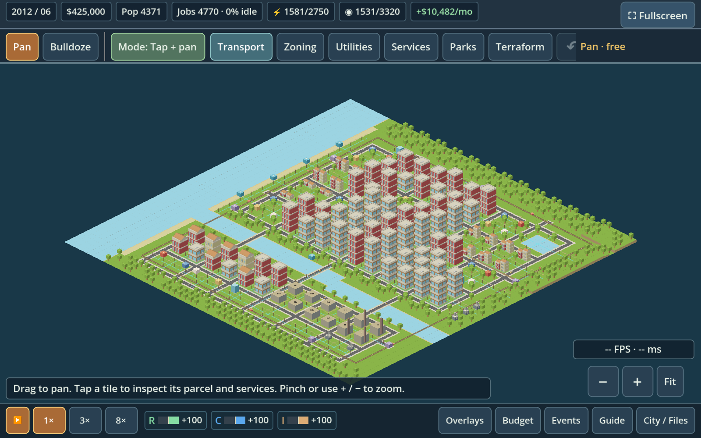
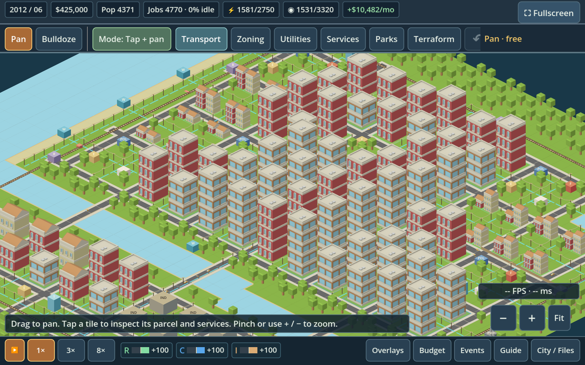

# Harbor City — showcase save

Download **MetroForge-Harbor-City.zip**, extract it, and import **MetroForge-Harbor-City.json** through **City / Files → Import JSON file** in the current native app. Save/export an existing city first if you want to keep it.



The prepared city starts with **4,371 residents**, **4,770 jobs**, **108 developed properties**, **$425,000** and a **+$10,482 monthly surplus**. It has **60 parks**, **six stations**, **eight trains**, **70 cars**, three road bridges and two rail crossings. Every developed property has electricity, water and road access.

The original 52 × 52 map now contains distinct neighborhoods: a dense Downtown, Midtown apartments, North Quarter, Central Park/ Parkside, elevated Hillcrest, garden neighborhoods, Eastbank Quays, Southbank and the manufacturing district. Plants on both banks, waterfront pumps, water storage, service alleys and neighborhood civic campuses support the city.



## Validation

This is a deliberately prepared showcase, with matured lots and a seeded treasury. Normal growth and traffic remain active; random disasters are disabled. Native export/import and the actual game file-selection callback were checked. After two simulated years it reached **5,290 residents** and **$727,656**, with zero developed properties lacking power/water and no abandoned or burning buildings. See `validation.json` for starting and ending metrics. Desktop checks do not establish phone frame rate.

The examples and native-game captures have been refreshed to use ordinary industry after Logistics was removed. The images are captures from the native game. No APK changes are required for this save.

To regenerate from the repository root (Godot 4.6.3):

```sh
godot --headless --audio-driver Dummy --path godot --script "$(pwd)/examples/build_showcase_city.gd" -- /tmp/metroforge-showcase
```
